# FicForge — Full-Stack Master Development Roadmap (v3.5)
**Stack:** Next.js 16+ (App Router, TypeScript) • PostgreSQL (Prisma ORM) • Tailwind CSS • PayPal Global • Vercel  
**Status:** In Active Execution • Vercel Production Connected • PostgreSQL Live • Unified Universal User Architecture

---

## 1. High-Level Architecture & Compliance Engine

```mermaid
flowchart TD
    subgraph UserLayer ["Unified User Architecture"]
        User["Registered User Account (Universal)"]
        User -->|Reader Capabilities| ReaderMode["Library Bookmarks • Tipping Sparks • Reading Progress"]
        User -->|Creator Capabilities| CreatorMode["Creator Studio (/write) • Manuscript Import • Chapters"]
        AdminAcc["Staff Admin Account"] -->|Dedicated URL| SecureAdmin["Secure Portal (/admin/login -> /admin)"]
    end

    subgraph ContentCompliance ["Content & Legal Compliance Controls"]
        FF[Fanfiction] -->|Safe Harbor Controls| FreeOnly[100% Free Chapters • Profile Tipping Only]
        Orig[Original Fiction] -->|Monetization Engine| FP[Fast Pass 7-Day Countdown Timer • Direct Subs]
        Exp[Explicit Rating E] -->|PayPal Policy Compliance| NoMonetization[Hard-Disabled Sparks & Fast Pass • 18+ Age Gate]
        Takedown[Takedown Portal] -->|Notice Review| SafeHarbor[Manual Admin Review Queue]
    end

    subgraph CreatorToolsEngine ["Publishing & Creator Ingestion Engine"]
        DirectCover[Direct Cover Upload / Drag & Drop] --> StoryWizard[Story Creation Wizard]
        FreeUpload[Core Bulk Upload 5-25+ Chs] --> ChapterReview[Interactive Chapter Review Table]
        PromoEngine[Spotlight: 2 Credits / Day] --> FeaturedQueue[Homepage Carousel Slider 3-4 Cards]
        ChapterReview --> DedicatedPage["Dedicated Chapter Sanctuary /story/slug/chapter-slug"]
    end

    subgraph FinancialEngine ["Financial & Global Payment Engine"]
        PP[PayPal Universal & Cards] -->|Sparks Storefront $0.99/100| Wallet[Sparks Ledger: Purchased vs Bonus vs Earned]
        PP -->|Recurring Subscriptions $2.99/$7.99/$14.99| Membership[Platform Memberships • Ad-Free Perks]
        Wallet -->|Transactions| Split[82% Creator Vault / 18% Platform]
        Split -->|7-14 Day Holding Buffer| ClearedVault[Cleared Earnings]
        ClearedVault -->|Threshold >= $50| Payouts[PayPal Payouts Batched 1st & 15th]
    end
```

---

## 2. Role-Based Access Control (RBAC) & Permission Matrix

FicForge uses a **Unified Consumer Model** (Readers are Creators & Creators are Readers) with a strictly segregated **Secure Administrative Gateway**:

| Platform Capability / Route | GUEST (Logged Out) | USER (Reader + Creator) | MODERATOR | SUPER_ADMIN (Staff) |
| :--- | :---: | :---: | :---: | :---: |
| **Browse & Read Public Works** | Yes | Yes | Yes | Yes |
| **Save Stories to Library / Bookmark** | Guest Auth Modal | **Yes (PostgreSQL DB)** | Yes | Yes |
| **Purchase Sparks & Tip Authors** | Auth Gate | **Yes** | Yes | Yes |
| **Creator Studio (`/write`, `/my-stories`)** | Auth Gate | **Full Access** | Read-Only | Full Access |
| **Create Stories (`/write/new`)** | Auth Gate | **Full Access** | No | Override |
| **Direct File Upload for Cover Images** | No | **Yes (File & Drag-Drop)**| No | Override |
| **Edit / Delete / Add Chapters** | **Hidden** | **Author-Only (`@username`)**| Override | Override |
| **Spotlight Promotion (2 Credits/Day)**| No | **Yes (Eligible stories)**| Audit | Full Control |
| **Admin Control Panel (`/admin`)** | **Blocked (403)**| **Blocked (403)** | Read-Only | **Full Access** |
| **Staff Security Gateway (`/admin/login`)** | Blocked | Blocked | Staff Passkey | **Master Staff Login** |
| **DMCA Safe Harbor & Moderation Appeals**| Submit Ticket | Submit Ticket | **Review & Action** | **Final Authority** |

---

## 3. Master Milestone Checklist

### Phase 1: Environment, Design System & Full-Stack Database
- [x] **1.1 Local Environment & Repository Initialization** (Node.js LTS, Next.js 16+ Turbopack, Tailwind CSS, Git)
- [x] **1.2 Design System & 38-Page Baseline Migration** (All core routes matching WordPress/Elementor designs 1:1)
- [x] **1.3 Database Architecture (Prisma ORM + Neon PostgreSQL)**
  - [x] Singleton Prisma Client with connection pooling.
  - [x] Complete Relational Schema: `User`, `Profile`, `Story`, `Chapter`, `Fandom`, `Genre`, `Tag`, `PlatformMembership`, `SparksWallet`, `CreatorVault`, `PayoutRequest`, `FinancialLedger`, `TakedownTicket`.
  - [x] Live Neon PostgreSQL connection verified and actively persisting records.

### Phase 2: Core Reader Experience & Creator Workshop
- [x] **2.1 Chapter Reader & Story Details ("Chapter Sanctuary")**
  - [x] Story Details page (`/story/[slug]`) with live metadata, stats, and chapters index.
  - [x] Dedicated Chapter Reader (`/story/[slug]/[chapterSlug]`) with distraction-free UI, font/theme controls.
  - [x] 18+ Age Verification Gateway (`/story/[slug]/age-gate`) for Explicit content.
- [x] **2.2 Creator Studio Publishing Engine**
  - [x] Creator Studio Dashboard (`/write` & `/my-stories`) with live database sync.
  - [x] Story Creation Wizard (`/write/new`) with direct file upload and drag-and-drop cover image support.
  - [x] Core Bulk Chapter Importer (`/write/bulk-import`) with multi-chapter parsing and 25-chapter batch test.
  - [x] Single Chapter Editor (`/write/chapter`) with live word count, autosave, and Author Notes.
- [x] **2.3 Discovery & Creator Spotlight Engine**
  - [x] Calibrated **2 Credits per Day** fair rate with multi-tier duration selector.
  - [x] Homepage **Carousel Slider** showcase (3–4 card dynamic carousel).
  - [x] 7-day fair rotation cooldown and anti-monopoly checks.
- [x] **2.4 Personal Library & Bookmarks**
  - [x] Full-stack PostgreSQL bookmark persistence via `/api/library`.
  - [x] Quick-access Navbar Bookmark icon button with live count badge.

### Phase 3: Roles, Authentication & Administrative Gateway *(Current Phase)*
- [x] **3.1 Unified User Role Architecture**
  - [x] Merged reader and creator into a single universal account (no artificial "Reader Account Detected" blocks).
  - [x] Strict Authorship Security: Delete, edit, and add chapter buttons only visible to story authors.
  - [x] Removed role split buttons (`Creator`, `Reader`, `Admin`) from main login page.
- [x] **3.2 Dedicated Secure Admin Portal**
  - [x] Staff login gateway at `/admin/login`.
  - [x] Protected Admin Console at `/admin` with PostgreSQL KPI monitoring, story moderation, spotlight overrides, and DMCA tracking.
- [x] **3.3 Production Auth & Encrypted Session Cookies**
  - [x] Implement encrypted, HTTP-only session cookies (`ficforge_session` via `jose` HS256).
  - [x] PostgreSQL database integration for user session upsert and identity verification.
  - [x] Server-side route middleware (`src/middleware.ts`) enforcing zero-trust guards on `/write`, `/my-stories`, and `/admin`.
  - [x] Secure authentication API endpoints (`/api/auth/login`, `/api/auth/session`, `/api/auth/logout`).
- [ ] **3.4 TOTP Two-Factor Authentication (2FA)**
  - [ ] Mandatory TOTP for staff accessing `/admin`.

### Phase 4: Full-Scale Administration, Moderation & Governance Control Center (Admin Panel)
*Dedicated administrative console at `/admin` powered by dedicated staff gateway `/admin/login`, backend API route `/api/admin`, and cryptographic JWT role-guards.*

- [x] **4.1 Executive Dashboard & System Health Telemetry**
  - [x] High-level KPI indicators: Total Stories, Chapters, Registered Authors/Readers, and Active Promotions.
  - [x] Live interactive SVG Analytics Charts (Reading Velocity Area Curve, Content Rating Donut, Catalog Breakdown).
  - [x] Database health telemetry (Neon PostgreSQL live connection, query latency indicators, and connection pool status).
- [x] **4.2 Master Content Catalog & Editorial Governance**
  - [x] Complete searchable story library with live filter by Title, Classification (Fanfiction vs Original), and Author.
  - [x] Force unpublish / hide story toggle (`Published` vs `Hidden / Draft`).
  - [x] Content Rating escalation (instant toggle to `EXPLICIT 18+`, `MATURE`, `TEEN`, `GENERAL`).
  - [x] Deep chapter inspection drawer (inspect raw chapter body, author notes, word counts).
  - [x] Permanent PostgreSQL purge/delete override for copyright violations or abusive content.
- [x] **4.3 User Directory, Account Governance & RBAC Management**
  - [x] User roster interface with avatar, username, email, active role, and verification badges.
  - [x] Live role assignment: `USER`, `MODERATOR`, `SUPER_ADMIN` with instant PostgreSQL sync.
  - [x] Account verification toggle (`Verified` vs `Unverified`).
- [x] **4.4 Creator Spotlight & Promotion Command Center**
  - [x] Active and historical spotlight campaign monitor with impressions & clicks.
  - [x] **Staff Manual Pinning Modal**: Staff can pin any story directly to the homepage Hero Spotlight for 1, 3, or 7 days with 0 credit cost.
  - [x] Emergency termination of abusive or low-quality promoted works.
  - [x] Test Cooldown Reset tool for development and staff testing.
- [x] **4.5 Legal, DMCA Safe Harbor & Appeals Clearinghouse**
  - [x] Compliance tab with DMCA Notice status indicators (`OPEN`, `UNDER_REVIEW`, `ACCEPTED_REMOVED`, `REJECTED`).
  - [x] Public story and chapter report modal (`ReportStoryModal`) with `/api/reports` live ticket creation.
  - [x] Interactive action buttons: Mark Under Review, Accept & Remove Content, Reject Claim, Add Moderator Review Notes.
  - [x] Statutory compliance guidelines overview (Fanfiction Safe Harbor, 10–14 business day Counter-Notice timer).
- [x] **4.6 Financial Audit & Payout Approval Desk (Bridge to Phase 5)**
  - [x] Sparks circulation audit (total Sparks in user wallets across FicForge).
  - [x] Creator revenue split tracking (82% Creator Vault / 18% Platform).
  - [x] Scheduled batch cashout calendar (1st & 15th with $50 threshold).
  - [x] Direct bridge to Phase 5 PayPal Orders API & mass payouts engine.
- [ ] **4.7 Community Moderation, Enforcement & Safety Architecture**
  - **4.7.1 Content Moderation & Editorial Integrity**
    - [x] Public Story & Chapter Report intake modal with direct DMCA Clearinghouse integration.
    - [x] Inaccurate age rating correction (General, Teen, Mature, Explicit) via instant dropdown.
    - [x] Temporary hide / unpublish toggle for stories under review (without altering author text).
    - [x] Deep chapter inspection drawer (read-only inspection of chapter text & author notes).
    - [ ] Misleading / prohibited story tag moderation drawer (correct tags without altering story prose).
    - [ ] Official notification dispatch to author explaining policy violations upon unpublishing or rating change.
  - **4.7.2 Comment & Community Interaction Governance**
    - [ ] Chapter comment moderation queue with inappropriate comment removal action.
    - [ ] Tiered user comment restrictions: 24 Hours, 3 Days, 7 Days, and 30 Days mutes.
    - [ ] Indefinite comment restriction workflow requiring Super Admin sign-off.
    - [ ] Community guideline warning system attached to user moderation history.
  - **4.7.3 User Account Enforcement & Tiered Suspensions**
    - [x] Public account directory view (username, avatar, email, verification, stories authored).
    - [ ] Tiered account suspensions: 24 Hours, 3 Days, 7 Days, and 30 Days login locks.
    - [x] Permanent bans, account deletions, and staff appointments hard-locked to Super Admin only.
    - [x] Zero-knowledge privacy: Moderators restricted from passwords, payments, or private billing details.
  - **4.7.4 Copyright, DMCA & Monetization Compliance**
    - [x] 100% Free Fanfiction Safe Harbor enforcement (hard-lock against Fast Pass paywalls).
    - [x] Live intake and review of copyright complaints with evidence links and digital signatures.
    - [x] Commercialization policy guard: Moderators can flag/disable monetized fanfiction.
    - [x] Financial isolation: Moderators restricted from altering balances, earnings splits, or payouts.
  - **4.7.5 Audit Trail, Appeals & Two-Factor Authentication (2FA)**
    - [x] Internal moderator notes attached to takedown tickets and review decisions.
    - [ ] Immutable staff audit log tracking moderator ID, action type, target ID, and timestamp.
    - [ ] In-app appeals submission portal within user dashboard (`/account`).
    - [ ] Mandatory TOTP Two-Factor Authentication (2FA) for all moderator and admin logins.

---

### Phase 5: PayPal Global Payments & Creator Vault 💳 (UPCOMING NEXT)
- [ ] **5.1 Sparks Storefront & PayPal Integration**
  - [ ] Sparks packages ($0.99 for 100 Sparks up to $124.99).
  - [ ] PayPal Standard & Card checkout via PayPal Orders API.
  - [ ] Sparks Ledger (purchased vs bonus vs earned).
- [ ] **5.2 Recurring Platform Memberships**
  - [ ] PayPal Subscriptions integration: Supporter ($2.99/mo), Forge Plus ($7.99/mo), Forge Elite ($14.99/mo).
  - [ ] Automated monthly bonus Sparks distribution and ad-free flag.
- [ ] **5.3 Fast Pass 7-Day Auto-Unlock Cron Job**
  - [ ] Scheduled job unlocking pending Original Fiction chapters when countdown expires.
- [ ] **5.4 Creator Cashouts (82/18 Split & Batched Payouts)**
  - [ ] 82% Creator Vault ledger with 7–14 day anti-fraud buffer.
  - [ ] PayPal Payouts batch processing on 1st & 15th (min $50 threshold).
