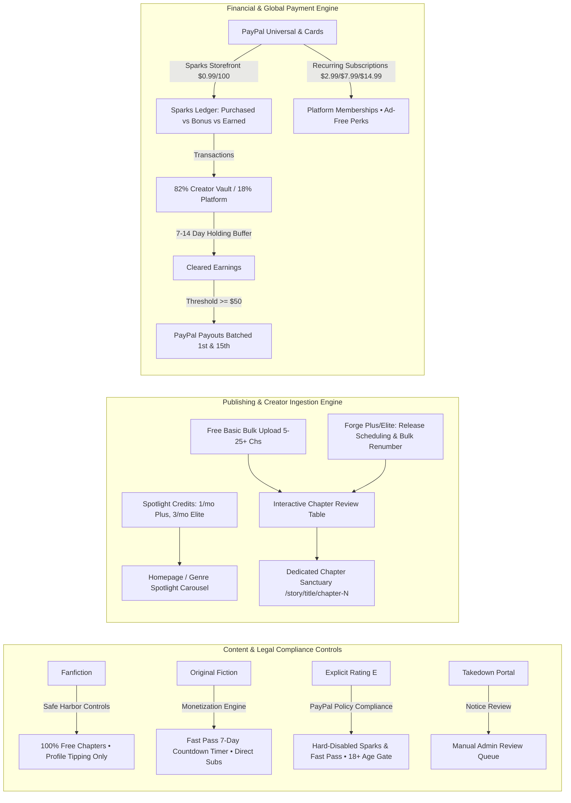

# FicForge — Full-Stack Master Development Roadmap (v3.4)
**Stack:** Next.js 15+ (App Router, TypeScript) • PostgreSQL (Prisma ORM) • Tailwind CSS • PayPal Global (Cards & Subscriptions) • Vercel  
**Status:** In Active Execution • Vercel Live Pipeline Connected • Database Architecture Completed • Incorporating Nov 10, 2026 Membership & Creator Specification

---

## Architecture & Compliance Firewalls

---

## Role-Based Access Control (RBAC) & Permission Matrix

FicForge strictly separates user capabilities across 5 distinct system roles defined in `prisma/schema.prisma` (`enum UserRole`):

| Platform Capability / Route | READER | CREATOR | MODERATOR | SUPPORT | SUPER_ADMIN |
| :--- | :---: | :---: | :---: | :---: | :---: |
| **Browse & Read Public Works** | Yes | Yes | Yes | Yes | Yes |
| **Comment & Bookmark Stories** | Yes | Yes | Yes | Yes | Yes |
| **Purchase Sparks & Tip Authors** | Yes | Yes | Yes | Yes | Yes |
| **Unlock Fast Pass Chapters** | Yes | Yes | Yes | Yes | Yes |
| **Creator Studio (`/write`, `/my-stories`)** | Preview Only | **Full Access** | Read-Only | Read-Only | **Full Access** |
| **Publish Stories & Manage Chapters** | No | **Yes (Own Works)**| No | No | **Yes (Override)** |
| **Creator Vault Earnings & Payout Requests** | No | **Yes (Own Vault)** | No | Read-Only | **Full Audit** |
| **Spotlight Promotion Credit Redemption** | No | **Yes (Plus/Elite)**| No | No | **Manual Grant** |
| **Content Moderation Queue & Appeals (`/moderation-appeals`)** | No | No | **Full Queue** | Read-Only | **Supervisory** |
| **DMCA Safe Harbor Takedowns (`/dmca-policy`)** | Submit Only | Submit Only | **Review & Action**| Read-Only | **Legal Admin** |
| **Manual Refund Processing (`/refund-policy`)** | Request Only | Deductions View | No | **Review & Action**| **Financial Sign-off**|
| **Financial Ledger & System Analytics** | No | Own Works Only | No | Read-Only | **Full Ledger Access**|
| **Admin 2FA (TOTP Enforcement)** | Optional | Optional | Mandatory | Mandatory | **Strictly Mandatory**|

---

## Membership & Creator Benefit Matrix (Nov 10, 2026 Handoff Spec)

| Capability / Benefit | Free ($0) | Supporter ($2.99/mo) | Forge Plus ($7.99/mo) | Forge Elite ($14.99/mo) |
| :--- | :---: | :---: | :---: | :---: |
| **Read Fanfiction & Public Stories** | **Yes (100% Free)** | **Yes (100% Free)** | **Yes (100% Free)** | **Yes (100% Free)** |
| **Ad-Free Reading Experience** | No | **Yes (Site-wide)** | **Yes (Site-wide)** | **Yes (Site-wide)** |
| **Monthly Bonus Sparks** | — | **50 / mo** | **150 / mo** | **350 / mo** |
| **Member Badge & Profile Accent** | Standard | Supporter Badge | Forge Plus Badge & Banner | Prestigious Gold Badge & Frame |
| **Core Multi-Chapter Bulk Upload** | **Yes (Up to 25+ chs)** | **Yes** | **Yes** | **Yes** |
| **Advanced Bulk Renumbering & Metadata** | No | No | **Yes** | **Yes** |
| **Chapter Release Scheduling Queue** | No | No | **Yes (Auto-timed releases)** | **Yes (Advanced queue)** |
| **Readership Analytics** | Basic views/likes | Basic views/likes | **Advanced (Retention heatmaps)**| **Expanded (Data export CSV)** |
| **Homepage Spotlight Promotion Credits** | No | No | **1 Credit / month** | **3 Credits / month** |
| **Priority Customer & Creator Support** | Standard | Improved | Priority | VIP 1-on-1 Fast-Track |

---

## Phase 1: Environment, Design System, Page Migration & Database
> **Objective:** Establish production environment, CI/CD, design system, client baseline pages, and core database schema.

- [x] **1.1 Local Environment & Repository Initialization**
  - [x] Install Node.js LTS and configure npm.
  - [x] Initialize Next.js 15+ App Router, TypeScript, and Tailwind CSS.
  - [x] Configure Git repository, `.gitignore`, and environment configuration templates (`.env.example`).
  - [x] Connect GitHub repository (`raheel2k29/FicForge`) to Vercel production deployment pipeline.

- [x] **1.2 Design System & 38-Page Baseline Migration**
  - [x] Extract colors, fonts, spacing, and styling from client's Elementor export (`ficforge-pages-code-final/`).
  - [x] Implement responsive layout shells (Sticky navigation header, mobile drawer navigation, full footer).
  - [x] Convert and deploy all 24 core routes (28 static pre-rendered pages) matching client's WordPress design 1:1.
  - [x] Overhaul Footer styling (`#030712`, trust badges, 4 columns, copyright disclaimer).
  - [x] Fix UTF-8 icon and emoji encoding across all headers, cards, and sections.

- [x] **1.3 Database Architecture (Prisma ORM + PostgreSQL)**
  - [x] Install Prisma ORM stable packages (`@prisma/client@6.4.1` & `prisma@6.4.1`).
  - [x] Setup singleton client in `src/lib/prisma.ts` for Next.js hot-reloading.
  - [x] Construct relational schema (`prisma/schema.prisma`):
    - [x] `User`, `Profile`, and `UserSecurity` (TOTP secrets for Admin 2FA).
    - [x] `Story` (Classification: Fanfiction vs Original, Status, Fandoms, Genres, Ratings).
    - [x] `Chapter` (Content, word count, order index, slug, Top/Bottom author notes, Fast Pass status).
    - [x] `Fandom`, `Genre`, `Tag`, `StoryFandom`, `StoryGenre`, `StoryTag` (Taxonomy and tagging).
    - [x] `PlatformMembership` (Tier, status, renewal dates, PayPal subscription ID, promo credits).
    - [x] `SparksWallet` (Separation of purchased, bonus, and creator-earned Sparks).
    - [x] `CreatorVault` & `PayoutRequest` (82/18 split, holding buffers, PayPal payouts).
    - [x] `FinancialLedger`, `RefundRequest`, `TakedownTicket`, `StoryAnalytics`.
  - [x] Generate typed client (`npx prisma generate`) and verify zero build errors.

---

## Phase 2: Dynamic Core Pages & Creator Publishing Tools
> **Objective:** Design and construct the critical interactive reading, publishing, storefront, and administrative pages based on the Nov 10 handoff spec.

- [x] **2.1 The Reading Experience ("Chapter Sanctuary")**
  - [x] **Story Details Page (`/story/[slug]`)**: Book cover, synopsis, tags, chapter index table, bookmark & tip actions.
  - [x] **Dedicated Chapter Reader (`/story/[slug]/[chapterSlug]`)**: Distraction-free mobile-first reader with zero body ads, reader preference controls (font size, serif/sans, line height, Dark/Sepia/Light theme), and Top/Bottom author notes.
  - [x] **18+ Age Verification Gateway (`/story/[slug]/age-gate`)**: Interstitial age advisory gateway for Explicit (E) rated stories.

- [x] **2.2 Creator Studio & Publishing Engine**
  - [x] **Creator Studio Dashboard (`/write` & `/my-stories`)**: Reactive workshop with real-time story management, statistics, and quick-action shortcuts.
  - [x] **Story Creation Wizard (`/write/new`)**: 3D cover preview, genre/tagging, audience ratings, and strict classification routing:
    - *Fanfiction*: 100% Free hard-lock (strictly free to read, zero paywalls).
    - *Original Fiction*: Unlocks Fast Pass and monetization.
  - [x] **Core Bulk Chapter Importer (`/write/bulk-import`) (Free Feature — 25-Chapter Test)**:
    - Single manuscript auto-splitter engine and batch multi-file uploader.
    - Pre-publish interactive review table (auto-detected numbers, editable titles, live word counts).
    - Atomic commitment: generates separate individual chapter records atomically (never merged).
    - One-click "Load 25-Chapter Test Batch" for effortless end-to-end testing.
  - [x] **Single Chapter Editor & Autosave (`/write/chapter`)**:
    - Reliable rich editor with live word count, reading time, simulated autosave, and Top/Bottom Author Notes.
    - Fast Pass early access settings for Original Fiction.
  - [x] **Forge Plus / Elite Advanced Publishing Tools**:
    - Staggered chapter release scheduler preview.
    - Bulk renumbering and title reindexing.

- [x] **2.3 Homepage & Discovery Spotlight Promotion Engine**
  - [x] Creator promotion dashboard (`/write/promote`) to redeem monthly membership credits (1 for Plus, 3 for Elite).
  - [x] Transparent public "✦ CREATOR SPOTLIGHT" gold showcase badge on homepage and discovery views.
  - [x] Strict compliance: Algorithmic rankings, reader reviews, and organic charts remain 100% uninfluenced.
  - [x] Real-time campaign tracking: dates, reader reach, impressions, and status.

- [ ] **2.4 Sparks Storefront & Membership Subscriptions** *(Current Focus)*
  - [ ] Sparks packages: Anchor $0.99 for 100 Sparks, Value $49.99 for 5,000 (+600 bonus), Elite $124.99 for 15,000.
  - [ ] PayPal Subscriptions integration for Supporter ($2.99), Forge Plus ($7.99), Forge Elite ($14.99).
  - [ ] Automatic subscription lifecycle handling & idempotent monthly bonus Spark grants.

---

## Phase 3: Authentication, Security (Admin 2FA) & Role-Based Access Control (RBAC)
> **Objective:** Enforce multi-tier permissions, secure credential management, role middleware, and dual-purpose user dashboards.

- [ ] **3.1 Authentication, Security & RBAC Enforcement**
  - [x] **Database Schema RBAC Foundation**: Defined `enum UserRole { READER, CREATOR, MODERATOR, SUPPORT, SUPER_ADMIN }` in `schema.prisma`.
  - [x] **Client Role Context & Author Gates**: Implemented `src/lib/authStore.ts` and `src/components/WriterAuthGate.tsx` protecting creator routes.
  - [ ] **Session & Token Management**: Implement Auth.js / NextAuth / Iron Session with secure, HTTP-only, encrypted session cookies.
  - [ ] **Server-Side RBAC Middleware (`middleware.ts`)**: Enforce permission checks before serving protected route trees:
    - `/write/*`, `/my-stories/*` ➔ Restricted to `CREATOR` and `SUPER_ADMIN`.
    - `/admin/moderation/*` ➔ Restricted to `MODERATOR` and `SUPER_ADMIN`.
    - `/admin/support/*` ➔ Restricted to `SUPPORT` and `SUPER_ADMIN`.
    - `/admin/finance/*` & `/admin/security/*` ➔ Strictly restricted to `SUPER_ADMIN`.
  - [ ] **Two-Factor Authentication (2FA / TOTP)**:
    - Mandatory TOTP verification (`UserSecurity.totpSecret`) for `SUPER_ADMIN` and `MODERATOR` logins.
    - Backup scratch codes stored hashed in PostgreSQL.
  - [ ] **API Endpoint Role Validation**: Server-side authorization wrappers ensuring callers can only mutate resources they own or have role delegation for.

- [ ] **3.2 Reader Dashboard & Personal Library**
  - [ ] Reading history tracking with chapter progress and scroll positions.
  - [ ] Library collections: Bookmarks, reading lists, followed authors.
  - [ ] Fast Pass unlocks repository and Sparks transaction receipt history.

- [ ] **3.3 Creator Analytics Hub & Readership Heatmaps**
  - [ ] Chapter-by-chapter reader drop-off rates and completion percentages.
  - [ ] Total reads, unique visitors, engagement time, and tip distributions.
  - [ ] Forge Elite CSV data export for external author analysis.

---

## Phase 4: Financial Reconciliation, Creator Cashouts & Admin Controls
> **Objective:** Realize the financial engine with transparent creator splits, fraud protection, and manual compliance gates.

- [ ] **4.1 Fast Pass 7-Day Timers (Vercel Cron Auto-Unlock)**
  - [ ] Vercel Cron job checking pending Fast Pass chapters every hour.
  - [ ] Automated transition from Fast Pass locked to public free reading once countdown reaches 0.

- [ ] **4.2 Manual Refund Review Queue (Strictly Zero Automated Refunds)**
  - [ ] Compliance portal for `SUPPORT` and `SUPER_ADMIN` to inspect refund requests.
  - [ ] Automated ledger debit calculation (preventing negative Sparks balances).

- [ ] **4.3 Creator Earnings Vault & PayPal Payouts (Batched 1st & 15th, Min $50)**
  - [ ] 82% Creator / 18% Platform split ledger tracking.
  - [ ] 7 to 14-day anti-fraud holding buffer before funds move to Cleared Vault.
  - [ ] Payout execution workflow requiring 2FA authorization.

- [ ] **4.4 Moderation Queue & Dedicated DMCA Takedown Portal**
  - [ ] DMCA takedown intake portal (`/dmca-policy`) feeding administrative queue.
  - [ ] Safe Harbor content isolation and counter-notice resolution workflow.
  - [ ] Appeals interface (`/moderation-appeals`) with moderator notes and resolution tracking.

---

## Scope Boundary & Post-Launch Roadmap
- [ ] **Community Forum Module**: Scheduled for Phase 2 Post-Launch.
- [ ] **Beta-Reader & Collaborator Workspace**: Scheduled for First Post-Launch Update.
- [ ] **Worldbuilding & Character Notes Workspace**: Scheduled for Later Update.
